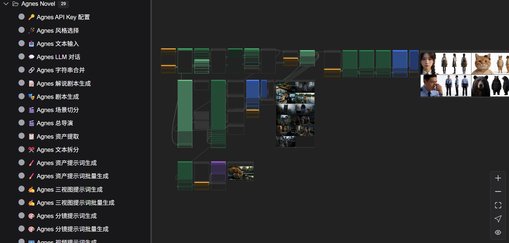
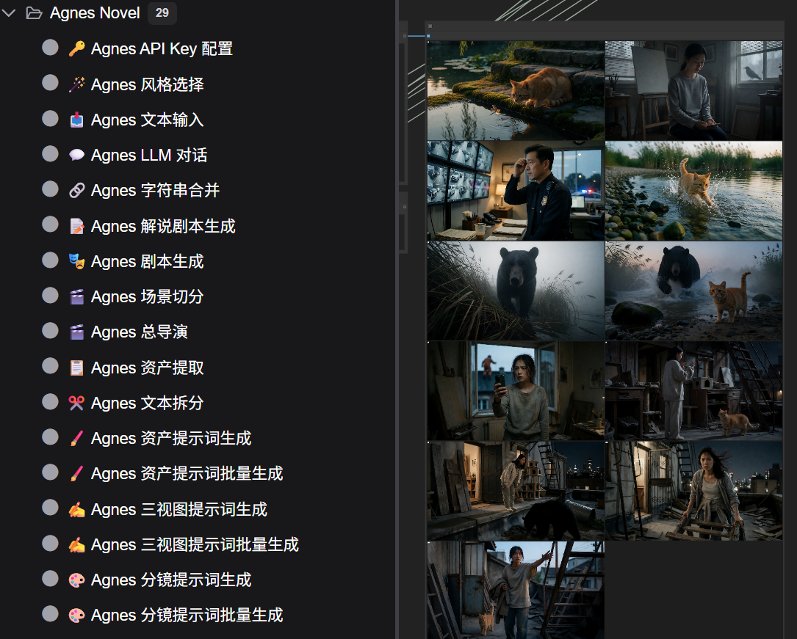

# ComfyUI Agnes Flash Suite
===========================

Agnes AI 全能力 ComfyUI 节点套件 — 29 个节点（19 文本 + 7 图片 + 3 视频），
覆盖 Agnes 模型全能力：LLM 对话/创作（小说·分镜·剧本·解说·漫剧）、
文生图/图生图/三视图/多图合成、文生视频/关键帧生视频/参考视频。

批量节点全部支持「JSON 合并输入/输出」：多槽输入输出一根 JSON 数组线搞定，
三大链路首尾相接，**全链路一根线到底，免逐槽手接**：

- **资产线**（定妆图）：文本拆分/资产提取 → 资产提示词批量 → 三视图提示词批量 → 三视图批量生成 → 图像拼图
- **分镜线**（关键帧 + 视频提示词）：总导演/场景切分 → 分镜提示词批量（60 镜·3 路分段）→ 分镜图批量 ×3（分波 60 镜全量）→ 图像拼图
- **视频线**（逐镜一对一）：分镜提示词批量 3 路分段 → 视频提示词批量 ×3 → 关键帧生视频

节点级接线入口（哪个输出连哪个输入）见下方「功能」各条；管线示例与排错见 [NODE_GUIDE.md](NODE_GUIDE.md)。

## 效果预览

ComfyUI 实测截图：

**资产线 + 分镜线同画布**：左侧 29 节点菜单；右侧 三视图批量生成 输出（4 个资产 ×「定妆 + 三视图」），中部 分镜图生成 逐帧出图，全链路同一画布直连：



**图像拼图输出**：分镜图批量 一波 14 帧自动汇成一张 2 列总览图（纯本地拼图，黑图占位自动跳过），逐帧看关键帧细节：



## 功能

文本类（19 个）：

- 🔑 Agnes API Key 配置
- 🪄 Agnes 风格选择节点：视觉风格 × 导演风格双轴，纯本地组合
- 📥 Agnes 文本输入节点：管线文本起点
- 📝 Agnes 解说剧本生成节点：影视解说文案/口播稿
- 🎭 Agnes 剧本生成节点：漫剧短视频分场剧本（钩子+画面/对白/氛围）
- 🎬 Agnes 场景切分节点：小说章节/剧本 → 5 秒场景段落 ×60；全文合并 JSON 数组输出
- 🎬 Agnes 总导演节点：章节/剧本 → 分镜（最多 60 组）；分镜总数 + 全文合并 JSON 数组输出
- 📋 Agnes 资产提取节点：角色/物品/场景清单
- ✂️ Agnes 文本拆分节点：按条数/字数/段落拆分（最多 20 条）；all_items 全部条目 JSON 输出（可一根线直连 批量节点合并输入）
- 🖌️ Agnes 资产提示词生成节点：角色/物品/场景三档定妆提示词
- 🖌️ Agnes 资产提示词批量生成节点：all_items 合并输入（JSON 数组，直连 资产提取 5 路 JSON / 文本拆分 all_items，免 20 路手接）并发生成英文提示词；输出 20 路提示词 + 整批执行状态 JSON + all_prompts 全部提示词 JSON 数组（可直连 三视图提示词批量生成）；线程池速率可限，默认 10
- ✍️ Agnes 三视图提示词生成节点：左 1/3 特写 + 右 2/3 三视图分栏布局
- ✍️ Agnes 三视图提示词批量生成节点：all_prompts 合并输入（JSON 数组，直连 资产提示词批量 all_prompts 输出，免 20 路手接）并发生成三视图提示词；输出 20 路提示词 + 整批执行状态 JSON + all_turnaround_prompts 全部三视图提示词 JSON 数组（可直连 三视图批量生成）；线程池速率可限，默认 10
- 🎨 Agnes 分镜提示词生成节点：单帧画面提示词；可注入 资产提取 角色/场景/服装/道具/天气 5 路 JSON
- 🎨 Agnes 分镜提示词批量生成节点：all_scenes 合并输入（JSON 数组，最多 60 条；对应 总导演/场景切分 all_scenes 输出，单条分镜纯文本也接受）并发生成英文提示词，可整批注入资产 5 路 JSON；输出 60 路提示词 + 整批执行状态 JSON + all_prompts 全部提示词 JSON 数组 + 3 路分段 all_prompts_1_20/_21_40/_41_60（3 个分段直连 分镜图批量 ×3 实例 all_prompts 分波出图控 RPM；亦为 视频提示词批量 ×3 实例 all_prompts 分波出视频提示词）；线程池速率可限，默认 10
- 🎞️ Agnes 视频提示词生成节点：单条分镜 → 视频模型英文提示词：mode 对应 3 个视频节点素材形态 keyframe=关键帧生视频（首帧已定只描述帧后运动）/ text=文生视频 / reference=参考视频生成（<Picture N>/<Audio N> 标记），台词/旁白非空才注入，输出直连视频节点 prompt 输入
- 🎞️ Agnes 视频提示词批量生成节点：all_prompts 一根线输入（直连 分镜提示词批量 任一分段 all_prompts_1_20/_21_40/_41_60，各段 JSON 数组 ≤20 条，3 实例分波控 RPM 出 60 镜全量视频提示词；单条英文提示词纯文本也接受）并发生成英文视频提示词；输出 20 路 video_prompt + 整批执行状态 JSON + all_video_prompts 全部视频提示词 JSON 数组（20 路 video_prompt 一对一连 关键帧生视频 prompt，槽号与同波 分镜图批量 image_N 对齐）；线程池速率可限，默认 10
- 🔗 Agnes 字符串合并
- 💬 Agnes LLM 对话节点：3.0/2.5 思考档位可切

图片类（7 个）：

- 🎨 Agnes 图像生成节点：文生图
- 🖼️ Agnes 图生图
- 📐 Agnes 三视图生成
- 📐 Agnes 三视图批量生成节点：all_prompts 合并输入（JSON 数组，直连 三视图提示词批量 all_turnaround_prompts 输出，免 20 路手接）并发出图；输出 20 路图 + 整批执行状态 JSON + all_images 批量图张量 (N,H,W,3)（可直连 图像拼图 总输入一根线出总览）；线程池速率可限，默认 10
- 🎞️ Agnes 分镜图批量生成节点：20 槽/波：all_prompts 一根线输入（直连 分镜提示词批量 任一分段 all_prompts_1_20/_21_40/_41_60，3 个实例各连一段=60 镜全量分波控 RPM；JSON 数组最多 20 条、超出截断）并发出 20 路分镜关键帧；单条提示词纯文本也接受；画质档位/宽高比可配（默认 2K + 16:9）；整批执行状态 JSON + all_images 批量图张量 (N,H,W,3)（可直连 图像拼图 batch_images，每波一张 20 图分段总览）输出；线程池速率可限，默认 10
- 🔍 Agnes 图像反推提示词
- 🧩 Agnes 图像拼图节点：batch_images 批量张量总输入（三视图批量/分镜图批量 all_images 直连，优先于 20 槽）或 20 路批量图 → 1 张 2 列网格拼图；全部 21 输入可选（不连线自动跳过不红框）；自动跳过黑图占位，N 动态定行数，纯本地

视频类（3 个）：

- 🎞️ Agnes 文生视频节点：4-12 秒时长直控 seconds + 固定 720P 分辨率项 + 宽高比；模型为 Agnes Video 2.5-flash；提交遇 503 队列满自动退避重试：「重试次数」参数可调 0-30（默认 5）
- 🎬 Agnes 关键帧生视频节点：首尾帧；prompt 输入可直连 Agnes 视频提示词生成/批量 输出的英文视频提示词，免手写运镜描述；4-12 秒直控 + 720P；同上文生视频的 503 退避
- 🎞️ Agnes 参考视频生成节点：最多 5 参考图 + 3 参考音频；4-12 秒直控 + 720P；同上文生视频的 503 退避

前端特性：

- 分类配色：Agnes 节点在画布上按功能整体染色（配置类=琥珀；文本类=绿；图片类=蓝；视频类=紫，同类同色系，主体色明显带色而非近黑），且类内按 主/浅/深 三阶小幅度区分主功能、次功能、工具与中间层；由前端扩展 `web/js/agnes-node-colors.js` 实现，仍可用右键「Set color」给单个节点换色
- 旧实例自愈：批量节点输入结构升级（如 分镜提示词批量 50 槽 → all_scenes 单输入）与视频节点结构演进（移除 1K/2K 画质档位 → 帧数/帧率 改 seconds 秒数直控 + 720P 分辨率项 + 模型单项）后，旧工作流实例的 widget 值在载入/排队时自动重映射（`web/js/agnes-migrate.js`：批量节点尾部配置重排、视频节点丢弃档位槽/帧数帧率推导秒数），避免「Value not in list」类校验报错
- 视频节点 seed 中文化：ComfyUI 内核会给任何名为 seed 的输入自动挂一个「生成后控制」英文下拉（提示语为内核硬编码英文、无法从套件本地化），3 个视频节点已在输入定义中禁用它；随机种子仍可用 seed 输入框旁的骰子按钮
- 视频提交退避：视频生成提交遇 503 队列满/429 限流时客户端自动退避重试，次数由节点「重试次数」参数控制（默认 5 次：间隔 10/30/60/60/60 秒，累计 220 秒；第 4 次起每次 60 秒，可调 0-30 次（上限 30 次累计约 28.7 分钟））
- 视频结果下载重试：生成成功后的视频文件下载自动重试 3 次（2/5/10 秒），仍失败时报错附带 `video_url`/`task_id`/`video_id` 与失败诊断（HTTP 状态/异常类型），链接有效期内可手动下载抢救

## 依赖

本套件**自包含**，API 客户端已内置于 `api/` 模块（AgnesClient，chat/images/video 三类端点），**不再依赖外部 comfyui-agnes-ai 插件**（旧版 README 中「comfyui-agnes-ai 提供核心 API 客户端」的说法已过时，该包的相关功能已并入本套件）。

- ComfyUI 本体即提供全部第三方库（requests / PyYAML / Pillow / numpy / torch / folder_paths），无需额外 pip 安装
- Python 3.10+

## 安装

1. 克隆本插件到 `ComfyUI/custom_nodes/`：
   ```powershell
   cd "你的ComfyUI路径\ComfyUI\custom_nodes"
   git clone https://github.com/Lusensec/Comfyui-Agnes-Flash-Suite.git
   ```
   或下载 ZIP 解压为 `ComfyUI/custom_nodes/Comfyui-Agnes-Flash-Suite/`
2. 重启 ComfyUI

## 配置 API Key

三种方式（可混用，优先级从高到低）：

1. 节点输入：在节点的 `api_key` 输入框直接填写
2. 环境变量：`AGNES_API_KEY`
3. 文件：`api_key_config.json`（由「🔑 Agnes API Key 配置」节点写入/缓存）

也可在内置 `config.yaml` 的 `api_key` 字段填写（优先级最低）。

## 配置

内置 `config.yaml` 可覆盖：

- `api.base_url`：默认 `https://api.agnes-ai.cn/v1`
- `api.video_max_wait` / `api.video_poll_interval`：视频生成轮询等待
- `models.chat` / `models.image` / `models.video`：默认模型
- `api_key`：默认 Key

## 节点详细说明

- [NODE_GUIDE.md](NODE_GUIDE.md)：每个节点的用法、管线示例与排错
- [INSTALL.md](INSTALL.md)：安装与配置指南
